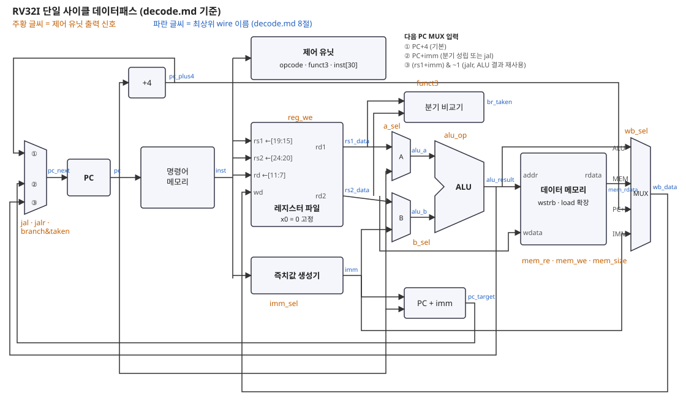

# ch05 단일 사이클 CPU — 디코드 표

> 제어 유닛이 명령어의 `opcode`·`funct3`·`funct7`을 보고 만들어야 하는 신호를 정리한 설계 기준표. RTL은 이 표대로 직접 입력한다.
> 기준: RISC-V Unprivileged ISA 명세 "RV32I Base Integer Instruction Set"과 "Instruction Set Listings" 표.

## 1. 데이터패스 가정 (단일 사이클)


```
PC ─► 명령어 메모리 ─► inst ─┬─► 레지스터 파일(rs1, rs2 읽기)
                              ├─► 즉치값 생성기 (imm_sel)
                              └─► 제어 유닛 ─► 아래 신호들
ALU 입력 A = rs1 또는 PC   (a_sel)
ALU 입력 B = rs2 또는 imm  (b_sel)
분기 비교기 = rs1 vs rs2   (funct3로 비교 종류 결정, ALU와 별도)
쓰기 값    = ALU 결과 / 메모리 읽기 값 / PC+4 / imm  (wb_sel)
다음 PC    = PC+4 / PC+imm(분기 성립·jal) / (rs1+imm) & ~1 (jalr)
```
- 분기 비교기를 ALU와 따로 두는 이유: 같은 사이클에 ALU는 다른 일을 해도 되고(분기 대상 주소는 별도 덧셈기), 제어가 단순해진다.
- `lui`는 ALU를 거치지 않고 `wb_sel = IMM`으로 바로 쓴다 (다른 방법: A=0, B=imm, ADD).
- **코어와 메모리 분리** (2026-11-10, 합성 준비): 그림의 명령어·데이터 메모리를 뺀 나머지가 `rv32i_core`(합성 대상)이고, `rv32i_sc`는 코어에 `imem`·`dmem`을 붙인 시뮬레이션·FPGA용 최상위다. gpdk045에는 SRAM 매크로가 없어 메모리를 합성하면 플립플롭 13만 개로 풀리기 때문이다. 바이트 처리(load 확장·store 바이트 선택·정렬 검사)는 코어 안의 `lsu`로 옮겨, 메모리는 워드 단위 RAM만 남는다. MCU 단계에서는 이 메모리 포트를 버스에 연결한다.
```
rv32i_sc
├── rv32i_core ── control, regfile, imm_gen, alu, branch_cmp, lsu   ← 합성 대상
├── imem   (imem_addr → imem_rdata, 비동기 읽기)
└── dmem   (dmem_addr·dmem_wstrb·dmem_wdata → dmem_rdata, 비동기 읽기·동기 쓰기)
```

## 2. 제어 신호
| 신호 | 폭 | 값 | 뜻 |
|------|:--:|----|----|
| `reg_we` | 1 | 0/1 | `rd`에 결과를 쓸지 (`rd = x0`이면 레지스터 파일이 무시) |
| `imm_sel` | 3 | I, S, B, U, J | 즉치값 생성 형식 |
| `a_sel` | 1 | RS1 / PC | ALU 입력 A |
| `b_sel` | 1 | RS2 / IMM | ALU 입력 B |
| `alu_op` | 4 | ADD SUB SLL SLT SLTU XOR SRL SRA OR AND | ALU 연산 (3절) |
| `mem_re` | 1 | 0/1 | 데이터 메모리 읽기 (load) |
| `mem_we` | 1 | 0/1 | 데이터 메모리 쓰기 (store) |
| `mem_size` | 3 | = `funct3` | 바이트/하프워드/워드, 부호 없는 load 여부 (4절) |
| `wb_sel` | 2 | ALU / MEM / PC4 / IMM | `rd`에 쓸 값 |
| `branch` | 1 | 0/1 | 조건 분기 명령어 (`funct3`로 비교 종류) |
| `jal` | 1 | 0/1 | 다음 PC = PC + immJ |
| `jalr` | 1 | 0/1 | 다음 PC = (rs1 + immI) & ~1 |
| `illegal` | 1 | 0/1 | 정의되지 않은 명령어 (3단계에서는 시뮬레이션 정지·FAIL, 6장에서 예외로) |

## 3. opcode별 신호
| 명령어 군 | opcode | 형식 | reg_we | imm_sel | a_sel | b_sel | alu_op | mem_re | mem_we | wb_sel | branch | jal | jalr |
|-----------|--------|:---:|:---:|:---:|:---:|:---:|------|:---:|:---:|:---:|:---:|:---:|:---:|
| OP (`add` 등 10개) | `0110011` | R | 1 | — | RS1 | RS2 | funct3·funct7 | 0 | 0 | ALU | 0 | 0 | 0 |
| OP-IMM (`addi` 등 9개) | `0010011` | I | 1 | I | RS1 | IMM | funct3 (+inst[30]은 `srai`만) | 0 | 0 | ALU | 0 | 0 | 0 |
| LOAD (`lw` 등 5개) | `0000011` | I | 1 | I | RS1 | IMM | ADD (주소) | 1 | 0 | MEM | 0 | 0 | 0 |
| STORE (`sw` 등 3개) | `0100011` | S | 0 | S | RS1 | IMM | ADD (주소) | 0 | 1 | — | 0 | 0 | 0 |
| BRANCH (6개) | `1100011` | B | 0 | B | — | — | — (비교기 사용) | 0 | 0 | — | 1 | 0 | 0 |
| LUI | `0110111` | U | 1 | U | — | — | — | 0 | 0 | IMM | 0 | 0 | 0 |
| AUIPC | `0010111` | U | 1 | U | PC | IMM | ADD | 0 | 0 | ALU | 0 | 0 | 0 |
| JAL | `1101111` | J | 1 | J | — | — | — | 0 | 0 | PC4 | 0 | 1 | 0 |
| JALR | `1100111` | I | 1 | I | RS1 | IMM | ADD (대상 주소) | 0 | 0 | PC4 | 0 | 0 | 1 |
| FENCE | `0001111` | I | 0 | — | — | — | — | 0 | 0 | — | 0 | 0 | 0 |
| SYSTEM (`ecall` `ebreak`) | `1110011` | I | 0 | — | — | — | — | 0 | 0 | — | 0 | 0 | 0 |
| 그 밖의 opcode | | | 0 | — | — | — | — | 0 | 0 | — | 0 | 0 | 0 |

- `—`는 아무 값이어도 결과에 영향이 없는 자리 (RTL에서는 기본값 하나로 정해 둔다).
- **FENCE**: 단일 사이클·캐시 없는 CPU에서는 메모리 순서가 이미 지켜지므로 아무 일도 하지 않음(NOP).
- **SYSTEM**: 3단계에서는 `illegal = 1`과 같은 취급(시뮬레이션 정지). 6장에서 트랩으로 구현.
- **그 밖의 opcode**: `illegal = 1`.
- **같은 opcode 안에서 정의되지 않은 조합도 illegal** (control.v에서 확인):
  - OP: funct7이 0000000이 아니면서 sub·sra(0100000)도 아님 (예: M 확장 `mul`)
  - OP-IMM 시프트: `slli`의 imm[11:5] ≠ 0000000, `srli/srai`의 imm[11:5]가 0000000·0100000이 아님
  - LOAD funct3 011·110·111, STORE funct3 011·1xx, BRANCH funct3 010·011, JALR funct3 ≠ 000, FENCE funct3 ≠ 000(`fence.i`)
- **값 이름**: `a_sel` = `` `A_RS1 ``/`` `A_PC ``, `b_sel` = `` `B_RS2 ``/`` `B_IMM ``, `wb_sel` = `` `WB_ALU ``/`` `WB_MEM ``/`` `WB_PC4 ``/`` `WB_IMM `` (`rv32i_defs.vh`)
- **illegal일 때**: 부작용이 있는 신호(`reg_we`, `mem_re`, `mem_we`, `branch`, `jal`, `jalr`)는 모두 0

## 4. ALU 연산 결정 (`alu_op`)
| funct3 | OP (R형) | OP-IMM (I형) | 주의 |
|:---:|------|------|------|
| `000` | inst[30]=0 → ADD, 1 → SUB | ADDI → **항상 ADD** | `addi`의 inst[30]은 즉치값 비트라 SUB로 보면 안 됨 (흔한 버그) |
| `001` | SLL | SLLI | `slli`는 inst[31:25]=0000000이어야 함 |
| `010` | SLT | SLTI | 부호 있는 비교, 결과 0/1 |
| `011` | SLTU | SLTIU | 부호 없는 비교. `sltiu`의 즉치값도 **부호 확장한 뒤** 부호 없이 비교 |
| `100` | XOR | XORI | |
| `101` | inst[30]=0 → SRL, 1 → SRA | inst[30]=0 → SRLI, 1 → SRAI | 시프트 양은 rs2[4:0] 또는 imm[4:0] |
| `110` | OR | ORI | |
| `111` | AND | ANDI | |

## 5. 분기 비교 (`branch = 1`)
| funct3 | 명령어 | 성립 조건 |
|:---:|------|------|
| `000` | beq | rs1 == rs2 |
| `001` | bne | rs1 != rs2 |
| `100` | blt | rs1 < rs2 (부호 있음) |
| `101` | bge | rs1 >= rs2 (부호 있음) |
| `110` | bltu | rs1 < rs2 (부호 없음) |
| `111` | bgeu | rs1 >= rs2 (부호 없음) |
| `010`, `011` | — | 정의 안 됨 → illegal |

## 6. load/store 크기 (`mem_size = funct3`)
| funct3 | load | store | 처리 |
|:---:|------|------|------|
| `000` | lb | sb | 바이트. load는 부호 확장 |
| `001` | lh | sh | 하프워드. load는 부호 확장 |
| `010` | lw | sw | 워드 |
| `100` | lbu | — | 바이트, 0 확장 |
| `101` | lhu | — | 하프워드, 0 확장 |
- 메모리는 워드(32비트) 단위로 두고, 주소 하위 2비트로 바이트 위치를 고른다. store는 **바이트 쓰기 신호(`wstrb[3:0]`)**로 해당 바이트만 쓴다.
- 정렬 안 된 접근(예: 주소가 4의 배수가 아닌 `lw`)은 `lsu`가 `misaligned = 1`을 내고 store는 하지 않는다(`dmem_wstrb = 0`). 3단계에서는 시뮬레이션 정지·FAIL, 6장에서 예외로.
- `lsu` 내부 (처음에는 `dmem` 안에 있었고 합성 준비 때 코어로 옮김): store는 `wstrb`(sb `0001<<off`, sh `0011<<{off[1],0}`, sw `1111`)와 바이트 위치로 복제한 쓰기 데이터, load는 워드에서 바이트·하프워드를 골라 확장.

## 7. 즉치값 생성기 (`imm_sel`)
| 형식 | 만드는 값 (32비트, 부호 비트 = inst[31]) |
|:---:|------|
| I | { 20 × inst[31], inst[31:20] } |
| S | { 20 × inst[31], inst[31:25], inst[11:7] } |
| B | { 19 × inst[31], inst[31], inst[7], inst[30:25], inst[11:8], 1'b0 } |
| U | { inst[31:12], 12'b0 } |
| J | { 11 × inst[31], inst[31], inst[19:12], inst[20], inst[30:21], 1'b0 } |

모듈 규약 (테스트벤치가 이 이름·값을 쓴다)
```verilog
module imm_gen (
    input  [31:0] inst,      // 명령어 전체
    input  [2:0]  imm_sel,   // 0:I  1:S  2:B  3:U  4:J  (그 밖의 값이면 imm = 0)
    output [31:0] imm        // 부호 확장된 즉치값 (조합 회로)
);
```
- 파일: `rtl/ch05_single_cycle/imm_gen.v`, 테스트벤치: `sim/ch05_single_cycle/imm_gen_tb.v`
- `imm_sel` 값은 이후 제어 유닛에서도 같은 값을 쓰므로 `` `define `` 헤더(`rtl/ch05_single_cycle/rv32i_defs.vh`)로 이름을 붙여 두면 좋다 (예: `` `IMM_I `` = 3'd0)

손 디코드 확인값 (riscv-tests 실제 명령어): `sw` `fc3f2223` → S = −60, `beq` `03ff0863` → B = +48, `jal` `0500006f` → J = +0x50, `lui` `800002b7` → U = 0x80000000.

## 8. 신호 이름 규칙
최상위 모듈에서 인스턴스를 연결할 때 연결 관계가 한눈에 보이도록 아래 이름을 모든 모듈·테스트벤치·블록 다이어그램에 똑같이 쓴다.

### 8.1 최상위 데이터 wire (블록 다이어그램 파란 글씨와 1:1)
| 그림 위치 | wire 이름 | 폭 |
|-----------|-----------|:--:|
| 다음 PC MUX 출력 | `pc_next` | 32 |
| PC 레지스터 출력 | `pc` | 32 |
| +4 덧셈기 출력 | `pc_plus4` | 32 |
| PC+imm 덧셈기 출력 (분기·jal 대상) | `pc_target` | 32 |
| 명령어 메모리 출력 | `inst` | 32 |
| 레지스터 파일 출력 | `rs1_data`, `rs2_data` | 32 |
| 즉치값 생성기 출력 | `imm` | 32 |
| A·B MUX 출력 (ALU 입력) | `alu_a`, `alu_b` | 32 |
| ALU 출력 | `alu_result` | 32 |
| 분기 비교기 출력 | `br_taken` | 1 |
| 데이터 메모리 정렬 오류 (`lsu` 출력) | `mem_misaligned` | 1 |
| 데이터 메모리 읽기 값 (`lsu`에서 load 확장 후) | `mem_rdata` | 32 |
| WB MUX 출력 (`rd`에 쓸 값) | `wb_data` | 32 |

- 코어 ↔ 메모리 포트 (`rv32i_core` 포트이자 `rv32i_sc`의 wire): 앞머리 `imem_`·`dmem_`
| 포트 | 폭 | 방향 (코어 기준) | 내용 |
|------|:--:|:--:|------|
| `imem_addr` | 32 | 출력 | = `pc` |
| `imem_rdata` | 32 | 입력 | = `inst` |
| `dmem_re` | 1 | 출력 | `mem_re & ~mem_misaligned` (비동기 RAM은 안 씀, 버스 연결용) |
| `dmem_addr` | 32 | 출력 | = `alu_result` |
| `dmem_wstrb` | 4 | 출력 | 쓸 바이트 (0이면 쓰기 없음) |
| `dmem_wdata` | 32 | 출력 | 바이트 위치로 복제한 `rs2_data` |
| `dmem_rdata` | 32 | 입력 | 메모리에서 읽은 워드 (확장 전) |

### 8.2 제어 신호
- 2절 표의 이름(`reg_we`, `imm_sel`, `a_sel`, `b_sel`, `alu_op`, `mem_re`, `mem_we`, `mem_size`, `wb_sel`, `branch`, `jal`, `jalr`, `illegal`)을 제어 유닛 출력 → 최상위 wire → 각 모듈 입력 포트까지 **같은 이름**으로 쓴다.
- 값은 `rv32i_defs.vh`의 `` `define `` 이름(`` `IMM_* ``, `` `ALU_* `` …)으로만 비교·대입한다.

### 8.3 접미사·앞머리
| 규칙 | 뜻 | 예 |
|------|----|----|
| `_sel` | MUX 선택 신호 | `imm_sel`, `wb_sel` |
| `_we` / `_re` | 쓰기·읽기 허가 | `reg_we`, `mem_we` |
| `_data` | 데이터 값 | `rs1_data`, `wb_data` |
| `_addr` | 주소 | `mem_addr` |
| `_n` | 0일 때 동작 (active low) | `rst_n` |
| `u_` (앞머리) | 인스턴스 이름 | `u_alu`, `u_imm_gen` |
| 모듈 이름 | 소문자 + `_` | `imm_gen`, `alu`, `regfile`, `control` |

### 8.4 모듈 포트
- 제어 신호 포트: 8.2 이름 그대로.
- 데이터 포트: 모듈 안에서 의미가 분명한 이름 (`a`, `b`, `result`, `imm` …). 최상위에서는 **이름으로 연결**(`.포트(wire)`)하고, 순서로 연결하지 않는다.
```verilog
alu u_alu (
    .a      (alu_a),
    .b      (alu_b),
    .alu_op (alu_op),
    .result (alu_result)
);
```

### 8.5 모듈별 포트와 최상위 연결
| 모듈 (인스턴스) | 포트 → 최상위 wire |
|------------------|--------------------|
| `imm_gen` (`u_imm_gen`) | `inst`→`inst`, `imm_sel`→`imm_sel`, `imm`→`imm` |
| `alu` (`u_alu`) | `a`→`alu_a`, `b`→`alu_b`, `alu_op`→`alu_op`, `result`→`alu_result` |
| `control` (`u_control`) | `inst`→`inst`, 제어 신호 13개 → 같은 이름의 wire (`reg_we`, `imm_sel`, `a_sel`, `b_sel`, `alu_op`, `mem_re`, `mem_we`, `mem_size`, `wb_sel`, `branch`, `jal`, `jalr`, `illegal`) |
| `branch_cmp` (`u_branch_cmp`) | `rs1_data`→`rs1_data`, `rs2_data`→`rs2_data`, `funct3`→`inst[14:12]`, `br_taken`→`br_taken` (실제 분기 = `branch & br_taken`) |
| `lsu` (`u_lsu`, 코어 안) | `mem_re`→`mem_re`, `mem_we`→`mem_we`, `mem_size`→`mem_size`, `addr`→`alu_result`, `wdata`→`rs2_data`, `rdata`→`mem_rdata`, `misaligned`→`mem_misaligned`, `dmem_wstrb`·`dmem_wdata`·`dmem_rdata`→코어 포트 |
| `imem` (`u_imem`, `rv32i_sc` 안) | `addr`→`imem_addr`, `inst`→`imem_rdata` |
| `dmem` (`u_dmem`, `rv32i_sc` 안) | `clk`, `addr`→`dmem_addr`, `wstrb`→`dmem_wstrb`, `wdata`→`dmem_wdata`, `rdata`→`dmem_rdata` |
| `regfile` (`u_regfile`) | `clk`, `reg_we`→`reg_we`, `rs1_addr`→`inst[19:15]`, `rs2_addr`→`inst[24:20]`, `rd_addr`→`inst[11:7]`, `rd_data`→`wb_data`, `rs1_data`→`rs1_data`, `rs2_data`→`rs2_data` |

## 9. 검증 방법 (riscv-tests 실행 환경)
riscv-tests의 기본 시작 코드(`env/p`)는 `csrr`·`csrw`(CSR 명령어), `mret`, `ecall`을 쓴다. CSR이 없는 3단계 CPU로는 시작 코드부터 실행할 수 없다.
- **3단계**: CSR을 쓰지 않는 **최소 테스트 환경**(`riscv_test.h`)을 직접 만든다.
  - 시작 코드는 바로 테스트로 들어간다.
  - PASS·FAIL은 `tohost` 주소에 결과를 쓰고 멈춘다 (PASS = 1, FAIL = (실패한 테스트 번호 << 1) | 1).
  - 테스트벤치가 `tohost` 쓰기를 감시해 판정한다.
- **제외**: `rv32ui-p-fence_i`(Zifencei 확장), `rv32ui-p-ma_data`(정렬 안 된 접근 — 6장에서 트랩과 함께)
- **6장 이후**: CSR과 트랩을 구현하면 원래 시작 코드(`env/p`)로 다시 돌려 확인한다.
- **구현 파일**
  - [`sim/riscv-tests-env/riscv_test.h`](../../sim/riscv-tests-env/riscv_test.h): 최소 환경 매크로
  - [`link.ld`](../../sim/riscv-tests-env/link.ld): 0x0 코드, 0x1000 tohost, 0x1040~ 데이터, 8 KB 안
  - [`build_rv32ui.sh`](../../sim/riscv-tests-env/build_rv32ui.sh): WSL에서 빌드·hex 변환
  - [`rv32i_sc_tb.v`](../../sim/ch05_single_cycle/rv32i_sc_tb.v): `+HEX=`로 프로그램 지정, tohost·trap·타임아웃 판정
  - [`run_riscv_tests.py`](../../sim/run_riscv_tests.py): 한 번 컴파일 후 테스트별 실행
- **결과**: [test.md](test.md) — rv32ui 40/40 PASS (2026-11-10)
